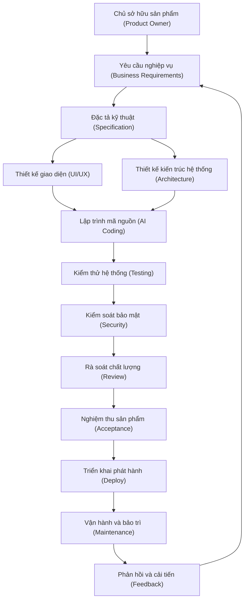

# Kỹ Năng Và Quy Tắc VibeCode Chuẩn (Vibecoding)

Bộ kỹ năng và quy tắc ràng buộc toàn diện nhằm chuẩn hóa quá trình phân tích, thiết kế, xây dựng, kiểm thử, bảo mật, triển khai phát hành và bảo trì phần mềm bằng phương pháp VibeCode có sự hỗ trợ của trí tuệ nhân tạo.

---

## I. Cấu Trúc Thư Mục

```text
├── plugin.json                    # Khai báo plugin
├── README.md                      # Giới thiệu và hướng dẫn sử dụng
├── rules/
│   └── AGENTS.md                  # Quy tắc bắt buộc luôn kích hoạt (Always-on Rules)
└── skills/
    └── vibecoding/
        └── SKILL.md               # Cẩm nang kỹ năng và hướng dẫn chi tiết 13 giai đoạn
```

---

## II. Các Nguyên Tắc Bắt Buộc

1. **Hành văn chuẩn mực:** Không viết tắt, không viết rườm rà, không tự bổ sung ghi chú không cần thiết, sử dụng tiếng Việt chuẩn xác (ngoại trừ thuật ngữ chuyên môn).
2. **Định danh và ngôn ngữ tệp:** Tất cả các tệp tài liệu tạo ra trong dự án phải được đánh số thứ tự hai chữ số ở đầu tên tệp (`01_...`, `02_...`), tên tệp và nội dung bằng tiếng Việt.
3. **Phân định vai trò:** Con người quyết định mục tiêu, nghiệp vụ, quy trình, quyền hạn, dữ liệu, phạm vi (WHAT và WHY). Trí tuệ nhân tạo hỗ trợ phân tích, thiết kế, lập trình, kiểm thử, bảo mật, triển khai, bảo trì (HOW và EXECUTION).
4. **Không suy đoán:** Khi yêu cầu không rõ ràng hoặc thiếu dữ liệu, phải dừng lại, mô tả vấn đề và yêu cầu xác nhận.
5. **Không phá vỡ dự án và không xóa chức năng:** Tuyệt đối không xóa mã nguồn, tệp tin hoặc chức năng nếu không có yêu cầu rõ ràng từ người dùng.
6. **Không tự ý phát sinh chức năng mới:** Chỉ dừng lại ở mức đề xuất giải pháp, bắt buộc phải chờ người dùng phê duyệt trước khi triển khai.
7. **Xây dựng từng bước nhỏ - Xác minh - Tiếp tục:** Chia nhỏ theo Sản phẩm -> Phân hệ -> Tính năng -> Nhiệm vụ.
8. **Điều kiện hoàn thành:** Đáp ứng đủ Yêu cầu + Quy tắc nghiệp vụ + Triển khai mã nguồn + Kiểm thử + Bảo mật + Triển khai (Deploy) + Bảo trì (Maintenance) + Rà soát + Nghiệm thu + Cập nhật tài liệu.

---

## III. Sơ Đồ Quy Trình 13 Giai Đoạn

### 1. Sơ đồ quy trình VibeCode tuần tự và cổng chất lượng

```mermaid
flowchart TD
    subgraph GIAI_DOAN_CHUAN_BI["GIAI ĐOẠN 1: KHỞI TẠO VÀ PHÂN TÍCH"]
        G01["01. Xác định ý tưởng<br/>(Tệp: 01_TONG_QUAN_DU_AN.md)"] --> G02["02. Xác định phạm vi<br/>(Tệp: 02_PHAM_VI_DU_AN.md)"]
        G02 --> G03["03. Phân tích nghiệp vụ<br/>(Tệp: 03_YEU_CAU_NGHIEP_VU.md đến 06_LUONG_NGHIEP_VU.md)"]
        G03 --> G04["04. Đặc tả yêu cầu và tiêu chí nghiệm thu<br/>(Tệp: 07_YEU_CAU_CHUC_NANG.md, 08_TIEU_CHI_NGHIEM_THU.md)"]
    end

    subgraph GIAI_DOAN_THIET_KE["GIAI ĐOẠN 2: THIẾT KẾ KỸ THUẬT VÀ DỮ LIỆU"]
        G04 --> G05["05. Thiết kế hệ thống và công nghệ<br/>(Tệp: 09_KIEN_TRUC_HE_THONG.md, 10_CONG_NGHE_SU_DUNG.md)"]
        G05 --> G06["06. Thiết kế giao diện người dùng<br/>(Tệp: 11_DAC_TA_GIAO_DIEN.md, 12_QUY_CHUAN_THIET_KE.md)"]
        G06 --> G07["07. Thiết kế cơ sở dữ liệu và API<br/>(Tệp: 13_CO_SO_DU_LIEU.md, 14_DAC_TA_API.md)"]
        G07 --> G08["08. Chuẩn bị môi trường AI và tài liệu quản lý<br/>(Tệp: 15, 16, index.md, 23_NHAT_KY_DU_AN.md, 24_DANH_MUC_KIEM_TRA.md)"]
    end

    subgraph GIAI_DOAN_TRIEN_KHAI_MA_NGUON["GIAI ĐOẠN 3: XÂY DỰNG VÀ KIỂM THỬ"]
        G08 --> G09["09. Xây dựng theo từng nhiệm vụ nhỏ<br/>(Mã nguồn, Migration, Unit Test)"]
        G09 --> G10["10. Kiểm thử đa tầng và hồi quy<br/>(Tệp: 17_KE_HOACH_KIEM_THU.md, 18_KICH_BAN_KIEM_THU.md)"]
    end

    subgraph GIAI_DOAN_BAO_MAT_DEPLOY_BAO_TRI["GIAI ĐOẠN 4: BẢO MẬT, TRIỂN KHAI VÀ BẢO TRÌ"]
        G10 --> G11["11. Bảo mật hệ thống - Security<br/>(Kiểm tra xác thực, phân quyền, mã hóa dữ liệu, quét lỗ hổng)<br/>(Tệp: 19_AN_TOAN_BAO_MAT.md)"]
        G11 --> QG1{"Cổng kiểm tra bảo mật<br/>(Đạt chuẩn không có lỗ hổng?)"}
        QG1 -- "Không đạt" --> G09
        QG1 -- "Đạt chuẩn" --> G12["12. Triển khai phát hành - Deploy<br/>(Đóng gói Build, cấu hình môi trường, CI/CD, Rollback Plan)<br/>(Tệp: 20_QUY_TRINH_TRIEN_KHAI.md, 22_LICH_SU_THAY_DOI.md)"]
        G12 --> QG2{"Cổng nghiệm thu phát hành<br/>(Vượt qua Smoke Test và kiểm tra sức khỏe?)"}
        QG2 -- "Có sự cố" --> ROLLBACK["Kích hoạt Rollback về phiên bản an toàn"] --> G09
        QG2 -- "Thành công" --> G13["13. Vận hành và bảo trì - Maintenance<br/>(Giám sát Monitoring, ghi nhật ký Logging, sao lưu Backup định kỳ)<br/>(Tệp: 21_KE_HOACH_BAO_TRI.md)"]
    end

    G13 --> FEEDBACK["Yêu cầu phát sinh mới hoặc phản hồi lỗi vận hành"]
    FEEDBACK --> G02
```



### 2. Sơ đồ mô hình quản trị dự án



---

## IV. Danh Mục Tài Liệu Chuẩn Trong Mỗi Dự Án

- `index.md`: Mục lục bộ tài liệu thiết kế (liên kết toàn bộ các tệp từ `01` đến `24`).
- `01_TONG_QUAN_DU_AN.md`: Xác định ý tưởng, mục tiêu sản phẩm, đối tượng sử dụng.
- `02_PHAM_VI_DU_AN.md`: Phạm vi phát triển trong và ngoài.
- `03_YEU_CAU_NGHIEP_VU.md`: Đặc tả chi tiết các luồng nghiệp vụ cốt lõi.
- `04_QUY_TAC_NGHIEP_VU.md`: Điều kiện, ràng buộc và công thức tính toán.
- `05_VAI_TRO_NGUOI_DUNG.md`: Danh sách nhóm người dùng, quyền hạn và trách nhiệm.
- `06_LUONG_NGHIEP_VU.md`: Sơ đồ và quy trình vận hành luồng nghiệp vụ.
- `07_YEU_CAU_CHUC_NANG.md`: Đặc tả yêu cầu chức năng hệ thống chi tiết.
- `08_TIEU_CHI_NGHIEM_THU.md`: Tiêu chí nghiệm thu chi tiết cho từng chức năng.
- `09_KIEN_TRUC_HE_THONG.md`: Thiết kế cấu trúc kỹ thuật tổng thể của hệ thống.
- `10_CONG_NGHE_SU_DUNG.md`: Danh mục công nghệ, ngôn ngữ, framework và thư viện.
- `11_DAC_TA_GIAO_DIEN.md`: Danh sách màn hình, bố cục và điều hướng người dùng.
- `12_QUY_CHUAN_THIET_KE.md`: Quy chuẩn thiết kế giao diện thống nhất.
- `13_CO_SO_DU_LIEU.md`: Cấu trúc cơ sở dữ liệu, bảng dữ liệu và quan hệ thực thể.
- `14_DAC_TA_API.md`: Đặc tả giao diện lập trình ứng dụng, điểm cuối, tham số và phản hồi.
- `15_QUY_TAC_PHAT_TRIEN_AI.md`: Quy tắc và ràng buộc phát triển dành cho trí tuệ nhân tạo.
- `16_CHI_DAN_HE_THONG_AI.md`: Ngữ cảnh và chỉ dẫn hệ thống cho trí tuệ nhân tạo.
- `17_KE_HOACH_KIEM_THU.md`: Chiến lược và kế hoạch kiểm thử chất lượng.
- `18_KICH_BAN_KIEM_THU.md`: Kịch bản và trường hợp kiểm thử cụ thể.
- `19_AN_TOAN_BAO_MAT.md`: Chính sách an toàn bảo mật, phân quyền và kiểm soát lỗ hổng (Security).
- `20_QUY_TRINH_TRIEN_KHAI.md`: Quy trình đóng gói, cấu hình môi trường, CI/CD và triển khai (Deploy).
- `21_KE_HOACH_BAO_TRI.md`: Kế hoạch giám sát, ghi nhật ký, sao lưu và bảo trì định kỳ (Maintenance).
- `22_LICH_SU_THAY_DOI.md`: Lịch sử các thay đổi qua từng phiên bản phát hành.
- `23_NHAT_KY_DU_AN.md`: Nhật ký hoạt động hàng ngày của dự án (cập nhật theo ngày).
- `24_DANH_MUC_KIEM_TRA.md`: Quản lý danh mục công việc cần xử lý và hoàn thành.

---

## V. Hướng Dẫn Cài Đặt

1. **Cài đặt toàn cục (Machine-local):**
   Sao chép thư mục này vào đường dẫn:
   ```text
   ~/.gemini/config/plugins/dev-lifecycle/
   ```
2. **Kích hoạt plugin trong `config.json`:**
   ```json
   {
     "plugins": {
       "dev-lifecycle": {
         "enabled": true
       }
     }
   }
   ```
3. **Sử dụng cho từng kho chứa mã nguồn riêng lẻ:**
   Sao chép tệp `rules/AGENTS.md` vào thư mục `.agents/rules/AGENTS.md` hoặc đặt tại thư mục gốc của dự án.
