# Quy Tắc Phát Triển Phần Mềm: Quy Trình VibeCode Chuẩn

## I. Nguyên Tắc Cốt Lõi Và Bắt Buộc

1. **Nguyên tắc giao tiếp và hành văn:**
   - Không viết tắt.
   - Không viết rườm rà, tập trung trực tiếp vào nội dung kỹ thuật và giải pháp.
   - Không tự bổ sung các ghi chú không cần thiết.
   - Không sử dụng tiếng Anh, ngoại trừ các thuật ngữ chuyên môn không thể dịch hoặc đã được chuẩn hóa trong ngành phần mềm.

2. **Nguyên tắc định danh và ngôn ngữ tệp tài liệu:**
   - Tất cả các tệp tài liệu được tạo ra theo yêu cầu trong quy trình bắt buộc phải được đánh số thứ tự hai chữ số ở đầu tên tệp (ví dụ: `01_...`, `02_...`).
   - Tên tệp và toàn bộ nội dung mô tả bên trong phải bằng tiếng Việt (ngoại trừ các thuật ngữ chuyên môn).
   - Tệp `index.md` là tệp MỤC LỤC BỘ TÀI LIỆU THIẾT KẾ của toàn bộ dự án, tập hợp liên kết và điều hướng đến toàn bộ các tệp tài liệu tiếng Việt đã được đánh số thứ tự.

3. **Vai trò giữa con người và trí tuệ nhân tạo:**
   - Con người chịu trách nhiệm quyết định: mục tiêu, yêu cầu nghiệp vụ, quy trình hoạt động, quyền hạn người dùng, quy tắc dữ liệu, tiêu chuẩn chất lượng, phạm vi sản phẩm (quyết định mục đích và lý do).
   - Trí tuệ nhân tạo chịu trách nhiệm hỗ trợ: phân tích, đề xuất, thiết kế kỹ thuật, viết mã nguồn, kiểm thử, phát hiện lỗi, lập tài liệu, tối ưu hóa (hỗ trợ phương pháp và thực thi).
   - Trí tuệ nhân tạo không được tự ý thay đổi các quyết định nghiệp vụ đã được phê duyệt.

4. **Nguyên tắc "Không suy đoán":**
   - Khi gặp yêu cầu không rõ ràng, có sự mâu thuẫn, thiếu dữ liệu, thiếu quy tắc nghiệp vụ hoặc không xác định được quyền hạn, trí tuệ nhân tạo không được tự suy đoán để lập trình.
   - Phải dừng lại, phát hiện vấn đề, mô tả vấn đề, xác định thành phần bị ảnh hưởng, đề xuất phương án và yêu cầu con người xác nhận.

5. **Nguyên tắc "Không phá vỡ dự án và không xóa chức năng":**
   - Tuyệt đối không phá vỡ dự án: không phá vỡ dữ liệu, không phá vỡ giao diện lập trình ứng dụng (API), không phá vỡ nghiệp vụ, không phá vỡ phân quyền, không phá vỡ giao diện và không làm gián đoạn các chức năng đang hoạt động.
   - Tuyệt đối không xóa bỏ bất kỳ chức năng, tệp tin, đoạn mã nguồn, cấu hình hoặc dữ liệu nào nếu người dùng không có yêu cầu rõ ràng.

6. **Nguyên tắc "Không tự ý phát sinh chức năng mới":**
   - Trí tuệ nhân tạo tuyệt đối không tự ý lập trình thêm các chức năng mới nằm ngoài phạm vi đã được phê duyệt.
   - Khi phát hiện nhu cầu cần thiết hoặc tính năng tiềm năng hữu ích, trí tuệ nhân tạo chỉ được phép dừng lại ở mức đưa ra đề xuất và bắt buộc phải chờ người dùng phê duyệt trước khi triển khai.

7. **Nguyên tắc "Xây dựng từng bước nhỏ - Xác minh - Tiếp tục":**
   - Không thực hiện lập trình toàn bộ hệ thống trong một lần.
   - Phải chia nhỏ: Sản phẩm -> Phân hệ (Module) -> Tính năng (Feature) -> Nhiệm vụ (Task).
   - Chu trình bắt buộc: Nhận nhiệm vụ -> Phân tích -> Xác nhận phạm vi -> Thiết kế giải pháp -> Con người xác nhận -> Triển khai -> Kiểm thử -> Rà soát -> Sửa lỗi -> Nghiệm thu -> Ghi nhận mã nguồn (Commit).

8. **Điều kiện hoàn thành:**
   - Một nhiệm vụ chỉ được xác nhận hoàn thành khi đáp ứng đầy đủ: Yêu cầu + Quy tắc nghiệp vụ + Triển khai mã nguồn + Kiểm thử + Bảo mật + Triển khai (Deploy) + Bảo trì (Maintenance) + Rà soát + Nghiệm thu + Cập nhật tài liệu.

9. **Nguyên tắc "Tài liệu phản ánh đúng thực tế":**
   - Tài liệu chỉ được mô tả một biện pháp, chức năng hoặc chỉ số là đã có khi mã nguồn thực tế đã triển khai và có kiểm thử hoặc bằng chứng xác minh tương ứng.
   - Khẳng định về bảo mật (xác thực, phân quyền, giới hạn tần suất, làm sạch dữ liệu, danh sách trắng) bắt buộc có kiểm thử tự động chứng minh, bao gồm cả trường hợp tấn công bị chặn.
   - Hạng mục chưa triển khai phải được ghi rõ là hạn chế đã biết hoặc nhiệm vụ chưa hoàn thành, không được đánh dấu hoàn thành trong danh mục kiểm tra.
   - Số liệu (số lượng bản ghi, phiên bản, số giai đoạn, số tệp) phải được lấy từ dữ liệu thực tế tại thời điểm cập nhật, không sinh ngẫu nhiên hoặc ước lượng.

---

## II. Quy Trình VibeCode Và Các Giai Đoạn Trọng Yếu

Mọi hoạt động phát triển phần mềm phải tuân thủ nghiêm ngặt các giai đoạn tuần tự. Mỗi giai đoạn đều phải kiểm tra cổng chất lượng trước khi chuyển tiếp:

```mermaid
flowchart TD
    subgraph GIAI_DOAN_CHUAN_BI["GIAI ĐOẠN 1: KHỞI TẠO VÀ PHÂN TÍCH"]
        G01["01. Xác định ý tưởng<br/>(Tệp: 01_TONG_QUAN_DU_AN.md)"] --> G02["02. Xác định phạm vi<br/>(Tệp: 02_PHAM_VI_DU_AN.md)"]
        G02 --> G03["03. Phân tích nghiệp vụ<br/>(Tệp: 03_YEU_CAU_NGHIEP_VU.md đến 06_LUONG_NGHIEP_VU.md)"]
        G03 --> G04["04. Đặc tả yêu cầu và tiêu chí nghiệm thu<br/>(Tệp: 07_YEU_CAU_CHUC_NANG.md, 08_TIEU_CHI_NGHIEM_THU.md)"]
    end

    subgraph GIAI_DOAN_THIET_KE["GIAI ĐOẠN 2: THIẾT KẾ KỸ THUẬT VÀ DỮ LIỆU"]
        G04 --> G05["05. Thiết kế hệ thống và công nghệ<br/>(Tệp: 09_KIEN_TRUC_HE_THONG.md, 10_CONG_NGHE_SU_DUNG.md)"]
        G05 --> G06["06. Thiết kế giao diện người dùng<br/>(Tệp: 11_DAC_TA_GIAO_DIEN.md, 12_QUY_CHUAN_THIET_KE.md)"]
        G06 --> G07["07. Thiết kế cơ sở dữ liệu và API<br/>(Tệp: 13_CO_SO_DU_LIEU.md, 14_DAC_TA_API.md)"]
        G07 --> G08["08. Chuẩn bị môi trường AI và tài liệu quản lý<br/>(Tệp: 15, 16, index.md, 23_NHAT_KY_DU_AN.md, 24_DANH_MUC_KIEM_TRA.md)"]
    end

    subgraph GIAI_DOAN_TRIEN_KHAI_MA_NGUON["GIAI ĐOẠN 3: XÂY DỰNG VÀ KIỂM THỬ"]
        G08 --> G09["09. Xây dựng theo từng nhiệm vụ nhỏ<br/>(Mã nguồn, Migration, Unit Test)"]
        G09 --> G10["10. Kiểm thử đa tầng và hồi quy<br/>(Tệp: 17_KE_HOACH_KIEM_THU.md, 18_KICH_BAN_KIEM_THU.md)"]
    end

    subgraph GIAI_DOAN_BAO_MAT_DEPLOY_BAO_TRI["GIAI ĐOẠN 4: BẢO MẬT, TRIỂN KHAI VÀ BẢO TRÌ"]
        G10 --> G11["11. Bảo mật hệ thống - Security<br/>(Kiểm tra xác thực, phân quyền, mã hóa dữ liệu, quét lỗ hổng)<br/>(Tệp: 19_AN_TOAN_BAO_MAT.md)"]
        G11 --> QG1{"Cổng kiểm tra bảo mật<br/>(Đạt chuẩn không có lỗ hổng?)"}
        QG1 -- "Không đạt" --> G09
        QG1 -- "Đạt chuẩn" --> G12["12. Triển khai phát hành - Deploy<br/>(Đóng gói Build, cấu hình môi trường, CI/CD, Rollback Plan)<br/>(Tệp: 20_QUY_TRINH_TRIEN_KHAI.md, 22_LICH_SU_THAY_DOI.md)"]
        G12 --> QG2{"Cổng nghiệm thu phát hành<br/>(Vượt qua Smoke Test và kiểm tra sức khỏe?)"}
        QG2 -- "Có sự cố" --> ROLLBACK["Kích hoạt Rollback về phiên bản an toàn"] --> G09
        QG2 -- "Thành công" --> G13["13. Vận hành và bảo trì - Maintenance<br/>(Giám sát Monitoring, ghi nhật ký Logging, sao lưu Backup định kỳ)<br/>(Tệp: 21_KE_HOACH_BAO_TRI.md)"]
    end

    G13 --> FEEDBACK["Yêu cầu phát sinh mới hoặc phản hồi lỗi vận hành"]
    FEEDBACK --> G02
```

### Chi tiết các giai đoạn và tệp tài liệu tương ứng:

1. **Giai đoạn 01 - Xác định ý tưởng:** Làm rõ vấn đề, mục tiêu, đối tượng sử dụng và giá trị mong muốn.
   - Tệp đầu ra: `01_TONG_QUAN_DU_AN.md`
2. **Giai đoạn 02 - Xác định phạm vi:** Phân định rõ phạm vi trong và phạm vi ngoài. Trí tuệ nhân tạo tuyệt đối không tự ý mở rộng phạm vi.
   - Tệp đầu ra: `02_PHAM_VI_DU_AN.md`
3. **Giai đoạn 03 - Phân tích nghiệp vụ:** Mô hình hóa đối tượng người dùng, vai trò, quy trình nghiệp vụ, quy tắc nghiệp vụ, trạng thái và các trường hợp ngoại lệ.
   - Tệp đầu ra: `03_YEU_CAU_NGHIEP_VU.md`, `04_QUY_TAC_NGHIEP_VU.md`, `05_VAI_TRO_NGUOI_DUNG.md`, `06_LUONG_NGHIEP_VU.md`
4. **Giai đoạn 04 - Đặc tả yêu cầu:** Chuyển nghiệp vụ thành yêu cầu chức năng, yêu cầu phi chức năng và tiêu chí nghiệm thu cụ thể.
   - Tệp đầu ra: `07_YEU_CAU_CHUC_NANG.md`, `08_TIEU_CHI_NGHIEM_THU.md`
5. **Giai đoạn 05 - Thiết kế hệ thống:** Xác định kiến trúc tổng thể (Frontend, Backend, Database, Authentication, Authorization), lựa chọn công nghệ và nguyên tắc kiến trúc.
   - Tệp đầu ra: `09_KIEN_TRUC_HE_THONG.md`, `10_CONG_NGHE_SU_DUNG.md`
6. **Giai đoạn 06 - Thiết kế giao diện:** Xác định danh sách màn hình, điều hướng, bố cục, thành phần giao diện, các trạng thái và thiết kế đáp ứng (Responsive).
   - Tệp đầu ra: `11_DAC_TA_GIAO_DIEN.md`, `12_QUY_CHUAN_THIET_KE.md`
7. **Giai đoạn 07 - Thiết kế dữ liệu và API:** Thiết kế mô hình dữ liệu (Database Schema, quan hệ, ràng buộc) và đặc tả giao diện lập trình ứng dụng (Endpoint, Request, Response, kiểm tra tính hợp lệ dữ liệu, mã lỗi).
   - Tệp đầu ra: `13_CO_SO_DU_LIEU.md`, `14_DAC_TA_API.md`
8. **Giai đoạn 08 - Chuẩn bị môi trường AI:** Thiết lập quy tắc lập trình, bối cảnh dự án, tiêu chuẩn viết mã nguồn và môi trường kiểm thử.
   - Tệp đầu ra: `15_QUY_TAC_PHAT_TRIEN_AI.md`, `16_CHI_DAN_HE_THONG_AI.md`
9. **Giai đoạn 09 - Xây dựng theo module:** Triển khai từng nhiệm vụ nhỏ theo thiết kế đã phê duyệt. Viết mã nguồn sạch, xử lý lỗi đầy đủ, không để phát sinh lỗi tiềm ẩn.
10. **Giai đoạn 10 - Kiểm thử và kiểm soát chất lượng:** Kiểm thử chức năng, nghiệp vụ, giao diện, phân quyền, tính toàn vẹn dữ liệu và kiểm thử hồi quy.
    - Tệp đầu ra: `17_KE_HOACH_KIEM_THU.md`, `18_KICH_BAN_KIEM_THU.md`
11. **Giai đoạn 11 - Bảo mật hệ thống (Security):**
    - Đánh giá và kiểm soát an toàn bảo mật đa tầng: xác thực (Authentication), phân quyền (Authorization), bảo vệ phiên làm việc, mã hóa dữ liệu lưu trữ và truyền tải, an toàn giao diện lập trình ứng dụng (API Security), kiểm tra tính hợp lệ dữ liệu đầu vào (Input Validation), phòng chống các lỗ hổng bảo mật phổ biến (Injection, XSS, CSRF, rò rỉ dữ liệu nhạy cảm).
    - Tệp đầu ra: `19_AN_TOAN_BAO_MAT.md`
12. **Giai đoạn 12 - Triển khai phát hành (Deploy):**
    - Quy chuẩn đóng gói mã nguồn (Build), cấu hình môi trường triển khai (Staging, Production), quản lý biến môi trường an toàn, thiết lập quy trình tự động hóa triển khai (CI/CD), thực hiện di chuyển dữ liệu (Migration), kiểm tra sức khỏe hệ thống sau triển khai và chuẩn bị phương án quay lui (Rollback).
    - Tệp đầu ra: `20_QUY_TRINH_TRIEN_KHAI.md`, `22_LICH_SU_THAY_DOI.md`
13. **Giai đoạn 13 - Vận hành và bảo trì (Maintenance):**
    - Giám sát trạng thái và hiệu năng hệ thống (Monitoring), ghi vết nhật ký tập trung (Logging), chính sách sao lưu và phục hồi dữ liệu định kỳ (Backup và Recovery), quy trình phát hiện và xử lý sự cố, quản lý các yêu cầu nâng cấp, tối ưu hóa và vá lỗi hệ thống.
    - Tệp đầu ra: `21_KE_HOACH_BAO_TRI.md`

---

## III. Cổng Kiểm Soát Chất Lượng

- **Không có đầu vào đạt chuẩn -> Không bắt đầu.**
- **Không có đầu ra đạt chuẩn -> Không chuyển giai đoạn.**
- **Không đạt tiêu chuẩn bảo mật -> Không được triển khai.**
- **Không có quy trình triển khai và phương án quay lui -> Không được phát hành.**
- **Không có phương án giám sát và bảo trì -> Không được vận hành chính thức.**
- **Không có tiêu chí nghiệm thu -> Không được coi là hoàn thành.**
- **Không có kiểm soát thay đổi -> Không được triển khai vào hệ thống.**

---

## IV. Bắt Buộc Khởi Tạo Và Duy Trì Các Tệp Quản Lý Cốt Lõi

Tại mỗi dự án phát triển phần mềm, trí tuệ nhân tạo bắt buộc phải tự động khởi tạo và duy trì các tệp tài liệu sau tại thư mục gốc của dự án:

1. **Tệp Mục lục bộ tài liệu thiết kế (`index.md`):**
   - Là tệp MỤC LỤC BỘ TÀI LIỆU THIẾT KẾ của toàn bộ dự án.
   - Tập hợp, phân loại và liên kết đến toàn bộ các tệp tài liệu tiếng Việt đã được đánh số thứ tự từ `01` đến `24`.
   - Phải được cập nhật đồng bộ mỗi khi có tài liệu thiết kế mới hoặc có sự điều chỉnh kiến trúc.

2. **Tệp Nhật ký dự án (`23_NHAT_KY_DU_AN.md`):**
   - Ghi lại nhật ký toàn bộ hoạt động của dự án và cập nhật theo từng ngày.
   - Nội dung mỗi ngày bao gồm: ngày thực hiện (theo định dạng Năm-Tháng-Ngày), mục tiêu trong ngày, các công việc đã xử lý, các quyết định kỹ thuật quan trọng, các lỗi phát sinh cùng phương án khắc phục và kết quả đạt được.
   - Phải được cập nhật liên tục sau mỗi nhiệm vụ hoặc cuối mỗi phiên làm việc.

3. **Tệp Danh mục kiểm tra (`24_DANH_MUC_KIEM_TRA.md`):**
   - Quản lý toàn bộ danh sách các công việc cần xử lý và trạng thái hoàn thành.
   - Phân cấp rõ ràng: Giai đoạn -> Phân hệ (Module) -> Tính năng (Feature) -> Nhiệm vụ (Task).
   - Mỗi hạng mục công việc phải thể hiện rõ: mã nhiệm vụ, nội dung công việc, tiêu chí nghiệm thu và trạng thái thực hiện (Chưa bắt đầu, Đang xử lý, Hoàn thành, Bị nghẽn).
   - Chỉ được đánh dấu hoàn thành khi đã đáp ứng đầy đủ tiêu chí nghiệm thu và vượt qua kiểm thử thực tế.
