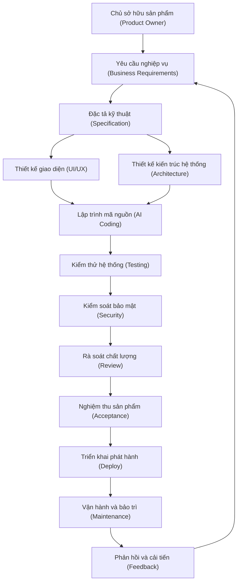

# Quy Trình VibeCode Chuẩn Trong Phát Triển Phần Mềm

Phiên bản: 2.0  
Mục đích: Chuẩn hóa toàn diện quá trình phân tích, thiết kế, xây dựng, kiểm thử, bảo mật, triển khai phát hành và bảo trì phần mềm bằng phương pháp VibeCode.

---

## I. Nguyên Tắc Cốt Lõi Và Bắt Buộc

1. **Nguyên tắc hành văn và giao tiếp:**
   - Không viết tắt.
   - Không viết rườm rà, tập trung trực tiếp vào nội dung kỹ thuật và giải pháp.
   - Không tự bổ sung các ghi chú không cần thiết.
   - Không sử dụng tiếng Anh, ngoại trừ các từ chuyên môn đã chuẩn hóa trong ngành kỹ thuật phần mềm.

2. **Nguyên tắc định danh và ngôn ngữ tệp tài liệu:**
   - Tất cả các tệp tài liệu được tạo ra theo yêu cầu bắt buộc phải được đánh số thứ tự hai chữ số ở đầu tên tệp (ví dụ: `01_...`, `02_...`).
   - Tên tệp và toàn bộ nội dung mô tả bên trong phải hoàn toàn bằng tiếng Việt (ngoại trừ các thuật ngữ chuyên môn).
   - Tệp `index.md` là tệp MỤC LỤC BỘ TÀI LIỆU THIẾT KẾ của toàn bộ dự án, tập hợp liên kết và điều hướng đến toàn bộ các tệp tài liệu tiếng Việt đã được đánh số thứ tự.

3. **Phân định vai trò:**
   - Con người chịu trách nhiệm quyết định: mục tiêu sản phẩm, yêu cầu nghiệp vụ, quy trình hoạt động, quyền hạn người dùng, quy tắc dữ liệu, tiêu chuẩn chất lượng, phạm vi sản phẩm. Con người quyết định mục đích và lý do.
   - Trí tuệ nhân tạo chịu trách nhiệm hỗ trợ: phân tích, đề xuất, thiết kế kỹ thuật, viết mã nguồn, kiểm thử, bảo mật, triển khai, bảo trì, phát hiện lỗi, lập tài liệu, tối ưu hóa. Trí tuệ nhân tạo hỗ trợ phương pháp và thực thi.
   - Trí tuệ nhân tạo tuyệt đối không tự ý thay đổi các quyết định nghiệp vụ đã được phê duyệt.

4. **Nguyên tắc "Không suy đoán":**
   - Khi gặp yêu cầu không rõ ràng, có sự mâu thuẫn, thiếu dữ liệu, thiếu quy tắc nghiệp vụ, không xác định được quyền hạn hoặc không xác định được hành vi hệ thống, trí tuệ nhân tạo không được tự suy đoán để lập trình.
   - Trí tuệ nhân tạo phải:
     1. Phát hiện vấn đề.
     2. Mô tả vấn đề.
     3. Xác định thành phần bị ảnh hưởng.
     4. Đưa ra phương án giải quyết.
     5. Yêu cầu con người xác nhận trước khi tiến hành.

5. **Nguyên tắc "Không phá vỡ dự án và không xóa chức năng":**
   - Tuyệt đối không phá vỡ dự án: không phá vỡ dữ liệu, không phá vỡ giao diện lập trình ứng dụng (API), không phá vỡ nghiệp vụ, không phá vỡ phân quyền, không phá vỡ giao diện và không làm gián đoạn các chức năng đang hoạt động.
   - Tuyệt đối không xóa bỏ bất kỳ chức năng, tệp tin, đoạn mã nguồn, cấu hình hoặc dữ liệu nào nếu người dùng không có yêu cầu rõ ràng.
   - Mọi thay đổi bắt buộc phải đảm bảo tính toàn vẹn của hệ thống và tuân thủ quy trình quản lý thay đổi.

6. **Nguyên tắc "Không tự ý phát sinh chức năng mới":**
   - Trí tuệ nhân tạo tuyệt đối không tự ý lập trình thêm các chức năng mới nằm ngoài phạm vi đã được phê duyệt.
   - Khi phát hiện nhu cầu cần thiết hoặc tính năng tiềm năng hữu ích, trí tuệ nhân tạo chỉ được phép dừng lại ở mức đưa ra đề xuất và bắt buộc phải chờ người dùng phê duyệt trước khi triển khai.

7. **Nguyên tắc "Xây dựng từng bước nhỏ - Xác minh - Tiếp tục":**
   - Không thực hiện lập trình toàn bộ hệ thống trong một lần.
   - Hệ thống bắt buộc phải được chia nhỏ:
     Sản phẩm -> Phân hệ (Module) -> Tính năng (Feature) -> Nhiệm vụ (Task).
   - Mỗi nhiệm vụ phải tuân thủ chu trình:
     Nhận nhiệm vụ -> Phân tích -> Xác nhận phạm vi -> Thiết kế giải pháp -> Con người xác nhận -> Triển khai mã nguồn -> Kiểm thử -> Rà soát -> Sửa lỗi -> Nghiệm thu -> Ghi nhận mã nguồn (Commit).

8. **Định nghĩa hoàn thành:**
   - Một nhiệm vụ chỉ được đánh dấu là hoàn thành khi đáp ứng toàn bộ các tiêu chí: Yêu cầu chức năng + Quy tắc nghiệp vụ + Triển khai mã nguồn + Kiểm thử + Bảo mật + Triển khai (Deploy) + Kế hoạch bảo trì (Maintenance) + Rà soát + Nghiệm thu + Cập nhật tài liệu.
   - Thiếu bất kỳ thành phần bắt buộc nào thì trạng thái phải là đang xử lý, cần sửa chữa hoặc bị nghẽn, không được đánh dấu là hoàn thành.

9. **Nguyên tắc "Tài liệu phản ánh đúng thực tế":**
   - Tài liệu chỉ được mô tả một biện pháp, chức năng hoặc chỉ số là đã có khi mã nguồn thực tế đã triển khai và có kiểm thử hoặc bằng chứng xác minh tương ứng.
   - Khẳng định về bảo mật (xác thực, phân quyền, giới hạn tần suất, làm sạch dữ liệu, danh sách trắng) bắt buộc có kiểm thử tự động chứng minh, bao gồm cả trường hợp tấn công bị chặn.
   - Hạng mục chưa triển khai phải được ghi rõ là hạn chế đã biết hoặc nhiệm vụ chưa hoàn thành, không được đánh dấu hoàn thành trong danh mục kiểm tra.
   - Số liệu (số lượng bản ghi, phiên bản, số giai đoạn, số tệp) phải được lấy từ dữ liệu thực tế tại thời điểm cập nhật, không sinh ngẫu nhiên hoặc ước lượng.

---

## II. Cấu Trúc Tổng Thể Quy Trình

### 1. Sơ đồ quy trình VibeCode 13 giai đoạn tuần tự

```mermaid
flowchart TD
    subgraph GIAI_DOAN_CHUAN_BI["GIAI ĐOẠN 1: KHỞI TẠO VÀ PHÂN TÍCH"]
        G01["01. Xác định ý tưởng<br/>(Tệp: 01_TONG_QUAN_DU_AN.md)"] --> G02["02. Xác định phạm vi<br/>(Tệp: 02_PHAM_VI_DU_AN.md)"]
        G02 --> G03["03. Phân tích nghiệp vụ<br/>(Tệp: 03_YEU_CAU_NGHIEP_VU.md đến 06_LUONG_NGHIEP_VU.md)"]
        G03 --> G04["04. Đặc tả yêu cầu và tiêu chí nghiệm thu<br/>(Tệp: 07_YEU_CAU_CHUC_NANG.md, 08_TIEU_CHI_NGHIEM_THU.md)"]
    end

    subgraph GIAI_DOAN_THIET_KE["GIAI ĐOẠN 2: THIẾT KẾ KỸ THUẬT VÀ DỮ LIỆU"]
        G04 --> G05["05. Thiết kế hệ thống và công nghệ<br/>(Tệp: 09_KIEN_TRUC_HE_THONG.md, 10_CONG_NGHE_SU_DUNG.md)"]
        G05 --> G06["06. Thiết kế giao diện người dùng<br/>(Tệp: 11_DAC_TA_GIAO_DIEN.md, 12_QUY_CHUAN_THIET_KE.md)"]
        G06 --> G07["07. Thiết kế cơ sở dữ liệu và API<br/>(Tệp: 13_CO_SO_DU_LIEU.md, 14_DAC_TA_API.md)"]
        G07 --> G08["08. Chuẩn bị môi trường AI và tài liệu quản lý<br/>(Tệp: 15, 16, index.md, 23_NHAT_KY_DU_AN.md, 24_DANH_MUC_KIEM_TRA.md)"]
    end

    subgraph GIAI_DOAN_TRIEN_KHAI_MA_NGUON["GIAI ĐOẠN 3: XÂY DỰNG VÀ KIỂM THỬ"]
        G08 --> G09["09. Xây dựng theo từng nhiệm vụ nhỏ<br/>(Mã nguồn, Migration, Unit Test)"]
        G09 --> G10["10. Kiểm thử đa tầng và hồi quy<br/>(Tệp: 17_KE_HOACH_KIEM_THU.md, 18_KICH_BAN_KIEM_THU.md)"]
    end

    subgraph GIAI_DOAN_BAO_MAT_DEPLOY_BAO_TRI["GIAI ĐOẠN 4: BẢO MẬT, TRIỂN KHAI VÀ BẢO TRÌ"]
        G10 --> G11["11. Bảo mật hệ thống - Security<br/>(Kiểm tra xác thực, phân quyền, mã hóa dữ liệu, quét lỗ hổng)<br/>(Tệp: 19_AN_TOAN_BAO_MAT.md)"]
        G11 --> QG1{"Cổng kiểm tra bảo mật<br/>(Đạt chuẩn không có lỗ hổng?)"}
        QG1 -- "Không đạt" --> G09
        QG1 -- "Đạt chuẩn" --> G12["12. Triển khai phát hành - Deploy<br/>(Đóng gói Build, cấu hình môi trường, CI/CD, Rollback Plan)<br/>(Tệp: 20_QUY_TRINH_TRIEN_KHAI.md, 22_LICH_SU_THAY_DOI.md)"]
        G12 --> QG2{"Cổng nghiệm thu phát hành<br/>(Vượt qua Smoke Test và kiểm tra sức khỏe?)"}
        QG2 -- "Có sự cố" --> ROLLBACK["Kích hoạt Rollback về phiên bản an toàn"] --> G09
        QG2 -- "Thành công" --> G13["13. Vận hành và bảo trì - Maintenance<br/>(Giám sát Monitoring, ghi nhật ký Logging, sao lưu Backup định kỳ)<br/>(Tệp: 21_KE_HOACH_BAO_TRI.md)"]
    end

    G13 --> FEEDBACK["Yêu cầu phát sinh mới hoặc phản hồi lỗi vận hành"]
    FEEDBACK --> G02
```



### 2. Sơ đồ mô hình quản lý và phân luồng trách nhiệm



---

## III. Chi Tiết Từng Giai Đoạn: Đầu Vào - Xử Lý - Đầu Ra - Tiêu Chí Kiểm Soát

### Giai Đoạn 01: Xác Định Ý Tưởng
- **Mục tiêu:** Xác định rõ vấn đề, mục tiêu và định hướng của sản phẩm.
- **Đầu vào:** Ý tưởng ban đầu, vấn đề cần giải quyết, nhu cầu của người dùng, bối cảnh hình thành sản phẩm.
- **Tiêu chí đầu vào:** Xác định được vấn đề hoặc nhu cầu, đối tượng liên quan, mục tiêu sơ bộ. Nếu chưa xác định được vấn đề cần giải quyết thì không chuyển sang giai đoạn tiếp theo.
- **Xử lý:** Phân tích vấn đề, xác định mục tiêu sản phẩm, đối tượng sử dụng, giá trị mang lại và kết quả mong muốn.
- **Đầu ra:** Tệp tổng quan dự án (`01_TONG_QUAN_DU_AN.md`).
- **Tiêu chí đầu ra:** Rõ ràng, không mâu thuẫn, diễn đạt chính xác, làm cơ sở vững chắc cho phân tích nghiệp vụ.

### Giai Đoạn 02: Xác Định Phạm Vi
- **Mục tiêu:** Xác định chính xác hệ thống được phép xây dựng những gì và không xây dựng những gì.
- **Đầu vào:** Tệp tổng quan dự án, mục tiêu sản phẩm, đối tượng sử dụng.
- **Xử lý:**
  - Xác định phạm vi trong: Chức năng bắt buộc, chức năng ưu tiên, chức năng phát triển sau, đối tượng dữ liệu cần quản lý, nhóm người dùng cần hỗ trợ.
  - Xác định phạm vi ngoài: Chức năng chưa triển khai, hệ thống chưa tích hợp, yêu cầu không thuộc phiên bản hiện tại.
- **Đầu ra:** Tệp phạm vi dự án (`02_PHAM_VI_DU_AN.md`).
- **Tiêu chí đầu ra:** Trả lời dứt khoát sản phẩm làm gì và không làm gì. Không tồn tại chức năng ở trạng thái không rõ thuộc phạm vi hay không.

### Giai Đoạn 03: Phân Tích Nghiệp Vụ
- **Mục tiêu:** Mô hình hóa toàn bộ nghiệp vụ trước khi viết mã nguồn.
- **Đầu vào:** Tệp phạm vi dự án, danh sách người dùng, quy trình hiện tại.
- **Xử lý:**
  - Xác định nhóm người dùng, vai trò, trách nhiệm, quyền hạn.
  - Xác định quy trình chính, quy trình phụ, quy trình ngoại lệ, điều kiện bắt đầu và điều kiện kết thúc.
  - Xác định quy tắc nghiệp vụ: điều kiện, ràng buộc, công thức, trạng thái và quy tắc chuyển trạng thái.
  - Xác định dữ liệu nghiệp vụ: dữ liệu đầu vào, đầu ra, dữ liệu bắt buộc, dữ liệu tùy chọn và quan hệ thực thể.
- **Đầu ra:**
  - `03_YEU_CAU_NGHIEP_VU.md`: Đặc tả chi tiết các yêu cầu nghiệp vụ.
  - `04_QUY_TAC_NGHIEP_VU.md`: Quy tắc, ràng buộc và điều kiện nghiệp vụ.
  - `05_VAI_TRO_NGUOI_DUNG.md`: Danh sách nhóm người dùng, quyền hạn và trách nhiệm.
  - `06_LUONG_NGHIEP_VU.md`: Sơ đồ và quy trình vận hành luồng nghiệp vụ.
- **Tiêu chí đầu ra:** Bao phủ toàn bộ nghiệp vụ trong phạm vi, xác định rõ người thực hiện, điều kiện, kết quả và các trường hợp ngoại lệ, không có mâu thuẫn nội bộ.

### Giai Đoạn 04: Đặc Tả Yêu Cầu
- **Mục tiêu:** Chuyển yêu cầu nghiệp vụ thành các yêu cầu kỹ thuật chi tiết để giao nhiệm vụ cho trí tuệ nhân tạo.
- **Đầu vào:** Toàn bộ tài liệu nghiệp vụ đã được phê duyệt ở giai đoạn 03.
- **Xử lý:** Chuyển đổi thành yêu cầu chức năng, yêu cầu phi chức năng và tiêu chí nghiệm thu. Mỗi chức năng phải có: mã định danh, tên chức năng, mục đích, người sử dụng, điều kiện tiên quyết, dữ liệu đầu vào, quy trình xử lý, kết quả đầu ra, quy tắc nghiệp vụ, trường hợp ngoại lệ, phân quyền, thông báo lỗi và tiêu chí nghiệm thu.
- **Đầu ra:**
  - `07_YEU_CAU_CHUC_NANG.md`: Đặc tả yêu cầu chức năng hệ thống.
  - `08_TIEU_CHI_NGHIEM_THU.md`: Tiêu chí nghiệm thu chi tiết cho từng chức năng.
- **Tiêu chí đầu ra:** Yêu cầu có thể hiểu mà không cần suy đoán, có thể triển khai, có thể kiểm thử và có tiêu chí xác định đúng hoặc sai rõ ràng.

### Giai Đoạn 05: Thiết Kế Kiến Trúc Hệ Thống
- **Mục tiêu:** Xác định cấu trúc kỹ thuật của toàn bộ hệ thống trước khi triển khai.
- **Đầu vào:** Tài liệu yêu cầu chức năng, phi chức năng, tiêu chí nghiệm thu, ràng buộc kỹ thuật.
- **Xử lý:**
  - Thiết kế kiến trúc tổng thể: Frontend, Backend, Database, API, Authentication, Authorization, File storage, Logging, Monitoring, Backup.
  - Lựa chọn công nghệ: Ngôn ngữ lập trình, framework, cơ sở dữ liệu, thư viện, công cụ kiểm thử và môi trường triển khai.
  - Xác định nguyên tắc kiến trúc: Khả năng mở rộng, khả năng bảo trì, tính ổn định, tính bảo mật, khả năng phục hồi.
- **Đầu ra:**
  - `09_KIEN_TRUC_HE_THONG.md`: Thiết kế cấu trúc kỹ thuật tổng thể của hệ thống.
  - `10_CONG_NGHE_SU_DUNG.md`: Danh mục công nghệ, ngôn ngữ, framework và thư viện.
- **Tiêu chí đầu ra:** Đáp ứng toàn bộ yêu cầu nghiệp vụ và yêu cầu phi chức năng, có giải pháp bảo mật và phương án triển khai rõ ràng.

### Giai Đoạn 06: Thiết Kế Giao Diện
- **Mục tiêu:** Xác định đầy đủ giao diện và trải nghiệm người dùng trước khi xây dựng.
- **Đầu vào:** Yêu cầu chức năng, vai trò người dùng, luồng nghiệp vụ, kiến trúc hệ thống.
- **Xử lý:** Thiết kế cấu trúc thông tin, danh sách màn hình, điều hướng, bố cục, thành phần giao diện, dữ liệu hiển thị, các trạng thái giao diện (bình thường, đang tải, dữ liệu rỗng, thông báo lỗi) và thiết kế đáp ứng (Responsive).
- **Đầu ra:**
  - `11_DAC_TA_GIAO_DIEN.md`: Danh sách màn hình, bố cục và điều hướng người dùng.
  - `12_QUY_CHUAN_THIET_KE.md`: Quy chuẩn thiết kế giao diện thống nhất.
- **Tiêu chí đầu ra:** Giao diện được thiết kế dựa trên nghiệp vụ và quyền hạn người dùng, có tính nhất quán và bao phủ đầy đủ các trạng thái hoạt động.

### Giai Đoạn 07: Thiết Kế Dữ Liệu Và API
- **Mục tiêu:** Xác định chi tiết cấu trúc dữ liệu và giao tiếp giữa các thành phần.
- **Đầu vào:** Thực thể nghiệp vụ, yêu cầu chức năng, quy tắc nghiệp vụ, kiến trúc hệ thống.
- **Xử lý:**
  - Thiết kế dữ liệu: Bảng dữ liệu, trường thông tin, kiểu dữ liệu, khóa chính, khóa ngoại, quan hệ, chỉ mục, ràng buộc toàn vẹn, trạng thái và chính sách xóa dữ liệu.
  - Thiết kế giao diện lập trình ứng dụng (API): Điểm cuối tiếp nhận (Endpoint), phương thức (Method), dữ liệu gửi đi (Request), dữ liệu phản hồi (Response), xác thực, phân quyền, kiểm tra tính hợp lệ dữ liệu, mã lỗi, phân trang và sắp xếp.
- **Đầu ra:**
  - `13_CO_SO_DU_LIEU.md`: Cấu trúc cơ sở dữ liệu, bảng dữ liệu và quan hệ thực thể.
  - `14_DAC_TA_API.md`: Đặc tả giao diện lập trình ứng dụng, điểm cuối, tham số và phản hồi.
- **Tiêu chí đầu ra:** Dữ liệu có quan hệ rõ ràng, không có trường thừa, giao diện lập trình ứng dụng có hợp đồng dữ liệu chuẩn xác và quy tắc kiểm tra tính hợp lệ đầy đủ.

### Giai Đoạn 08: Chuẩn Bị Môi Trường AI
- **Mục tiêu:** Thiết lập bộ ngữ cảnh và quy tắc phát triển trước khi giao nhiệm vụ lập trình cho trí tuệ nhân tạo.
- **Đầu vào:** Toàn bộ tài liệu đặc tả đã được phê duyệt từ các giai đoạn trước.
- **Xử lý:** Thiết lập bối cảnh dự án, các quy tắc phát triển phần mềm của trí tuệ nhân tạo, tiêu chuẩn viết mã nguồn, cấu trúc kho chứa mã nguồn, chiến lược phân nhánh và môi trường kiểm thử.
- **Đầu ra:**
  - `15_QUY_TAC_PHAT_TRIEN_AI.md`: Quy tắc và ràng buộc phát triển dành cho trí tuệ nhân tạo.
  - `16_CHI_DAN_HE_THONG_AI.md`: Ngữ cảnh và chỉ dẫn hệ thống cho trí tuệ nhân tạo.
- **Tiêu chí đầu ra:** Trí tuệ nhân tạo có đầy đủ thông tin để hiểu sản phẩm, phạm vi, nghiệp vụ, kiến trúc, dữ liệu, tiêu chuẩn lập trình và giới hạn quyền hạn của mình.

### Giai Đoạn 09: Xây Dựng Theo Module
- **Mục tiêu:** Triển khai mã nguồn sạch, chính xác và bám sát thiết kế.
- **Đầu vào:** Nhiệm vụ cụ thể có đầy đủ mục tiêu, phạm vi, dữ liệu đầu vào, kết quả đầu ra, tiêu chí nghiệm thu và các ràng buộc kỹ thuật.
- **Xử lý:** Tiến hành lập trình tuần tự theo từng nhiệm vụ nhỏ. Viết mã nguồn sạch, xử lý lỗi tại đúng tầng, không để sập ứng dụng, không sửa các thành phần không liên quan.
- **Đầu ra:** Mã nguồn hoàn chỉnh, mã nguồn chuyển đổi cơ sở dữ liệu (Migration nếu có), các kiểm thử tự động tương ứng.
- **Tiêu chí đầu ra:** Mã nguồn chạy đúng thiết kế, tuân thủ tiêu chuẩn lập trình, có kiểm thử kèm theo và không gây ảnh hưởng tiêu cực đến chức năng hiện có.

### Giai Đoạn 10: Kiểm Thử Và Kiểm Soát Chất Lượng
- **Mục tiêu:** Đảm bảo hệ thống hoạt động chính xác theo tiêu chí nghiệm thu và không có lỗi tiềm ẩn.
- **Đầu vào:** Mã nguồn đã hoàn thành, trường hợp kiểm thử (Test Cases), tiêu chí nghiệm thu.
- **Xử lý:** Thực hiện kiểm thử trên các tầng:
  1. Kiểm thử chức năng.
  2. Kiểm thử nghiệp vụ.
  3. Kiểm thử giao diện.
  4. Kiểm thử phân quyền theo từng vai trò.
  5. Kiểm thử dữ liệu (tính hợp lệ, tính toàn vẹn, trùng lặp).
  6. Kiểm thử hồi quy (đảm bảo chức năng mới không làm hỏng chức năng cũ).
- **Đầu ra:**
  - `17_KE_HOACH_KIEM_THU.md`: Chiến lược và kế hoạch kiểm thử chất lượng.
  - `18_KICH_BAN_KIEM_THU.md`: Kịch bản và trường hợp kiểm thử cụ thể.
- **Tiêu chí đầu ra:** Toàn bộ tiêu chí nghiệm thu bắt buộc phải đạt 100%, không còn lỗi nghiêm trọng chưa được xử lý.

### Giai Đoạn 11: Bảo Mật Hệ Thống (Security)
- **Mục tiêu:** Đảm bảo toàn bộ hệ thống an toàn trước các nguy cơ tấn công, rò rỉ dữ liệu và lỗ hổng bảo mật.
- **Đầu vào:** Mã nguồn hoàn chỉnh, kiến trúc hệ thống, cấu hình máy chủ, tài liệu giao diện lập trình ứng dụng (API).
- **Xử lý:**
  - **Xác thực và phân quyền:** Kiểm tra an toàn mật khẩu, cơ chế khóa tài khoản, hạn sử dụng token, phân quyền theo vai trò (RBAC), kiểm tra phân quyền tại từng API và từng tác vụ dữ liệu.
  - **Kiểm tra tính hợp lệ dữ liệu:** Kiểm tra dữ liệu đầu vào tại cả Frontend và Backend, ngăn chặn các tấn công chèn mã (SQL Injection, NoSQL Injection, XSS, Command Injection).
  - **Bảo mật giao tiếp và dữ liệu:** Mã hóa dữ liệu lưu trữ (Encryption at rest), mã hóa dữ liệu truyền tải (TLS/HTTPS), không lưu trữ thông tin nhạy cảm ở dạng thô (mật khẩu, khóa riêng, token bí mật).
  - **Bảo vệ API:** Giới hạn tần suất gọi (Rate limiting), chống giả mạo yêu cầu (CSRF), thiết lập chính sách chia sẻ tài nguyên nguồn gốc chéo (CORS) nghiêm ngặt.
  - **Rà soát lỗ hổng phụ thuộc:** Quét mã nguồn và các gói thư viện phụ thuộc để phát hiện và khắc phục các lỗ hổng đã biết.
- **Đầu ra:**
  - `19_AN_TOAN_BAO_MAT.md`: Đặc tả chính sách an toàn thông tin, danh mục kiểm tra bảo mật và biên bản rà soát an toàn.
- **Tiêu chí đầu ra:** Không có lỗ hổng bảo mật mức nghiêm trọng (Critical) hoặc mức cao (High). Đáp ứng đầy đủ danh mục kiểm tra an toàn bảo mật.

### Giai Đoạn 12: Triển Khai Phát Hành (Deploy)
- **Mục tiêu:** Đóng gói, kiểm tra tính sẵn sàng vận hành và triển khai sản phẩm lên môi trường thực tế an toàn, không gián đoạn dịch vụ.
- **Đầu vào:** Mã nguồn đã vượt qua kiểm thử và kiểm tra bảo mật, cấu hình môi trường, kịch bản di chuyển dữ liệu (Migration).
- **Xử lý:**
  - **Đóng gói mã nguồn (Build):** Thực hiện đóng gói sản phẩm bản phát hành (Production Build), tối ưu kích thước gói và kiểm tra các cảnh báo biên dịch.
  - **Cấu hình môi trường:** Quản lý an toàn các biến môi trường qua tệp cấu hình mẫu (`.env.example`), không để lộ khóa bí mật trong mã nguồn.
  - **Tự động hóa triển khai (CI/CD):** Xây dựng kịch bản tích hợp liên tục và triển khai liên tục đảm bảo tính lặp lại và ổn định.
  - **Di chuyển dữ liệu (Database Migration):** Thực hiện nâng cấp cấu trúc cơ sở dữ liệu có kiểm soát, chạy dữ liệu khởi tạo (Seed data nếu có).
  - **Xác nhận sau triển khai (Smoke Test):** Kiểm tra các luồng nghiệp vụ cốt lõi, kiểm tra điểm cuối trạng thái hoạt động (Health check).
  - **Phương án quay lui (Rollback Plan):** Thiết lập sẵn quy trình và bản sao lưu để khôi phục phiên bản trước đó ngay lập tức khi phát sinh sự cố phát hành.
- **Đầu ra:**
  - `20_QUY_TRINH_TRIEN_KHAI.md`: Hướng dẫn các bước đóng gói, cấu hình môi trường, kịch bản triển khai và phương án quay lui.
  - `22_LICH_SU_THAY_DOI.md`: Lịch sử các phiên bản phát hành, danh sách tính năng mới và lỗi đã khắc phục.
- **Tiêu chí đầu ra:** Triển khai thành công trên môi trường mục tiêu, vượt qua kiểm tra sức khỏe hệ thống, có phương án quay lui sẵn sàng.

### Giai Đoạn 13: Vận Hành Và Bảo Trì (Maintenance)
- **Mục tiêu:** Duy trì sự ổn định, hiệu năng cao, phát hiện và xử lý sự cố kịp thời trong suốt quá trình hệ thống vận hành.
- **Đầu vào:** Hệ thống vận hành thực tế, dữ liệu tải, nhật ký hệ thống, phản hồi từ người dùng.
- **Xử lý:**
  - **Giám sát hệ thống (Monitoring):** Theo dõi liên tục mức độ sử dụng tài nguyên (CPU, bộ nhớ, dung lượng đĩa, mạng), thời gian phản hồi API và tỷ lệ lỗi.
  - **Ghi vết nhật ký (Logging):** Thiết lập cơ chế ghi nhật ký tập trung với các cấp độ rõ ràng (Error, Warn, Info, Debug), không ghi lộ dữ liệu cá nhân hay dữ liệu nhạy cảm.
  - **Sao lưu và phục hồi dữ liệu (Backup & Recovery):** Thiết lập lịch sao lưu tự động cơ sở dữ liệu và tệp tin định kỳ, kiểm tra định kỳ tính toàn vẹn của bản sao lưu và diễn tập kịch bản phục hồi.
  - **Quy trình ứng cứu sự cố:** Quy định rõ các bước tiếp nhận, khoanh vùng, khắc phục, báo cáo nguyên nhân gốc rễ và đề xuất biện pháp phòng ngừa.
  - **Bảo trì định kỳ và tối ưu hóa:** Cập nhật các bản vá lỗi bảo mật của framework và thư viện, tối ưu hóa chỉ mục cơ sở dữ liệu, dọn dẹp dữ liệu rác định kỳ.
- **Đầu ra:**
  - `21_KE_HOACH_BAO_TRI.md`: Quy định giám sát, quy chuẩn ghi nhật ký, lịch sao lưu phục hồi và quy trình xử lý sự cố.
- **Tiêu chí đầu ra:** Hệ thống có cơ chế cảnh báo tự động khi phát sinh lỗi, sao lưu hoạt động đều đặn và có quy trình vận hành rõ ràng.

---

## IV. Cấu Trúc Chuẩn Của Một Nhiệm Vụ (Task)

Mỗi nhiệm vụ giao cho trí tuệ nhân tạo phải có đầy đủ các mục:
1. Mã nhiệm vụ và tên nhiệm vụ.
2. Mục tiêu.
3. Phạm vi.
4. Yêu cầu nghiệp vụ.
5. Quy tắc nghiệp vụ.
6. Dữ liệu liên quan.
7. Giao diện liên quan.
8. Giao diện lập trình ứng dụng (API) liên quan.
9. Phân quyền người dùng.
10. Yêu cầu an toàn bảo mật.
11. Ràng buộc triển khai (Deploy).
12. Yêu cầu bảo trì và giám sát (Maintenance).
13. Điều kiện đặc biệt và trường hợp biên.
14. Tiêu chí nghiệm thu.
15. Trường hợp kiểm thử.
16. Ràng buộc kỹ thuật.
17. Những thành phần tuyệt đối không được thay đổi.

---

## V. Cổng Kiểm Soát Chất Lượng (Quality Gate)

Trước khi chuyển giao giữa các giai đoạn, phải kiểm tra 6 tiêu chuẩn đầu vào:
1. **Đầy đủ:** Không thiếu thông tin bắt buộc theo phạm vi.
2. **Rõ ràng:** Không có nội dung đa nghĩa hoặc mơ hồ.
3. **Nhất quán:** Không có mâu thuẫn với các tài liệu và quyết định trước đó.
4. **Có thể kiểm tra:** Mọi tiêu chí đều có phương pháp đo lường hoặc kiểm thử.
5. **Có thể truy xuất:** Có thể truy vết ngược về yêu cầu nghiệp vụ gốc.
6. **Được phê duyệt:** Có sự xác nhận chính thức từ con người.

Nếu không đạt một trong các tiêu chuẩn trên:
**DỪNG LẠI -> LÀM RÕ -> CẬP NHẬT -> KIỂM TRA LẠI.**

---

## VI. Quản Lý Tài Liệu Dự Án

Toàn bộ các tệp tài liệu được tạo ra trong dự án bắt buộc phải được đánh số thứ tự hai chữ số ở đầu tên tệp, tên tệp và phần mô tả hoàn toàn bằng tiếng Việt:

- `index.md`: Mục lục bộ tài liệu thiết kế của toàn bộ dự án.
- `01_TONG_QUAN_DU_AN.md`: Mục tiêu sản phẩm, vấn đề cần giải quyết, đối tượng sử dụng.
- `02_PHAM_VI_DU_AN.md`: Phạm vi phát triển trong và phạm vi ngoài.
- `03_YEU_CAU_NGHIEP_VU.md`: Đặc tả chi tiết các yêu cầu nghiệp vụ cốt lõi.
- `04_QUY_TAC_NGHIEP_VU.md`: Điều kiện, ràng buộc và công thức tính toán.
- `05_VAI_TRO_NGUOI_DUNG.md`: Danh sách nhóm người dùng, quyền hạn và trách nhiệm.
- `06_LUONG_NGHIEP_VU.md`: Sơ đồ và quy trình vận hành luồng nghiệp vụ.
- `07_YEU_CAU_CHUC_NANG.md`: Đặc tả yêu cầu chức năng hệ thống chi tiết.
- `08_TIEU_CHI_NGHIEM_THU.md`: Tiêu chí nghiệm thu chi tiết cho từng chức năng.
- `09_KIEN_TRUC_HE_THONG.md`: Thiết kế cấu trúc kỹ thuật tổng thể của hệ thống.
- `10_CONG_NGHE_SU_DUNG.md`: Danh mục công nghệ, ngôn ngữ, framework và thư viện.
- `11_DAC_TA_GIAO_DIEN.md`: Danh sách màn hình, bố cục và điều hướng người dùng.
- `12_QUY_CHUAN_THIET_KE.md`: Quy chuẩn thiết kế giao diện thống nhất.
- `13_CO_SO_DU_LIEU.md`: Cấu trúc cơ sở dữ liệu, bảng dữ liệu và quan hệ thực thể.
- `14_DAC_TA_API.md`: Đặc tả giao diện lập trình ứng dụng, điểm cuối, tham số và phản hồi.
- `15_QUY_TAC_PHAT_TRIEN_AI.md`: Quy tắc và ràng buộc phát triển dành cho trí tuệ nhân tạo.
- `16_CHI_DAN_HE_THONG_AI.md`: Ngữ cảnh và chỉ dẫn hệ thống cho trí tuệ nhân tạo.
- `17_KE_HOACH_KIEM_THU.md`: Chiến lược và kế hoạch kiểm thử chất lượng.
- `18_KICH_BAN_KIEM_THU.md`: Kịch bản và trường hợp kiểm thử cụ thể.
- `19_AN_TOAN_BAO_MAT.md`: Chính sách an toàn bảo mật, phân quyền và kiểm soát lỗ hổng.
- `20_QUY_TRINH_TRIEN_KHAI.md`: Quy trình đóng gói, cấu hình môi trường, CI/CD và triển khai (Deploy).
- `21_KE_HOACH_BAO_TRI.md`: Kế hoạch giám sát, ghi nhật ký, sao lưu và bảo trì định kỳ (Maintenance).
- `22_LICH_SU_THAY_DOI.md`: Lịch sử các thay đổi qua từng phiên bản phát hành.
- `23_NHAT_KY_DU_AN.md`: Nhật ký hoạt động hàng ngày của dự án (cập nhật theo ngày).
- `24_DANH_MUC_KIEM_TRA.md`: Quản lý danh mục công việc cần xử lý và hoàn thành.

---

## VII. Bắt Buộc Khởi Tạo Và Duy Trì Các Tệp Quản Lý Cốt Lõi

Tại mỗi dự án phần mềm, trí tuệ nhân tạo bắt buộc phải tự động khởi tạo và cập nhật liên tục ba tệp tài liệu quản lý cốt lõi tại thư mục gốc:

### 1. Tệp Mục Lục Bộ Tài Liệu Thiết Kế (`index.md`)
- **Mục đích:** Là MỤC LỤC BỘ TÀI LIỆU THIẾT KẾ của toàn bộ dự án, tập hợp liên kết và điều hướng đến toàn bộ hệ thống tài liệu đặc tả và thiết kế kỹ thuật bằng tiếng Việt đã được đánh số thứ tự từ `01` đến `24`.
- **Quy tắc cập nhật:** Khởi tạo ngay từ đầu và bổ sung liên kết đồng bộ mỗi khi có tài liệu mới hoặc có sự điều chỉnh kiến trúc.
- **Cấu trúc mẫu của `index.md`:**

```markdown
# Mục Lục Bộ Tài Liệu Thiết Kế

Tài liệu này tổng hợp toàn bộ các đặc tả thiết kế, kiến trúc, an toàn bảo mật, quy trình triển khai và bảo trì của dự án. Toàn bộ các tệp được đánh số thứ tự và mô tả chi tiết bằng tiếng Việt.

## I. Tổng Quan Và Phạm Vi
- [01. Tổng quan dự án](01_TONG_QUAN_DU_AN.md): Mục tiêu sản phẩm, vấn đề cần giải quyết, đối tượng sử dụng.
- [02. Phạm vi phát triển](02_PHAM_VI_DU_AN.md): Phạm vi trong (In-Scope) và phạm vi ngoài (Out-of-Scope).

## II. Phân Tích Nghiệp Vụ
- [03. Yêu cầu nghiệp vụ](03_YEU_CAU_NGHIEP_VU.md): Đặc tả chi tiết các luồng nghiệp vụ cốt lõi.
- [04. Quy tắc nghiệp vụ](04_QUY_TAC_NGHIEP_VU.md): Điều kiện, ràng buộc và công thức tính toán.
- [05. Vai trò người dùng](05_VAI_TRO_NGUOI_DUNG.md): Danh sách nhóm người dùng, quyền hạn và trách nhiệm.
- [06. Luồng nghiệp vụ](06_LUONG_NGHIEP_VU.md): Sơ đồ và quy trình vận hành chi tiết.

## III. Đặc Tả Kỹ Thuật Và Yêu Cầu
- [07. Yêu cầu chức năng](07_YEU_CAU_CHUC_NANG.md): Đặc tả chức năng chi tiết từng phân hệ.
- [08. Tiêu chí nghiệm thu](08_TIEU_CHI_NGHIEM_THU.md): Điều kiện đánh giá hoàn thành cho từng chức năng.

## IV. Thiết Kế Kiến Trúc Và Hệ Thống
- [09. Kiến trúc hệ thống](09_KIEN_TRUC_HE_THONG.md): Sơ đồ kiến trúc tổng thể, các tầng và phân hệ.
- [10. Công nghệ sử dụng](10_CONG_NGHE_SU_DUNG.md): Ngôn ngữ lập trình, framework, cơ sở dữ liệu và thư viện.

## V. Thiết Kế Giao Diện (UI/UX)
- [11. Đặc tả giao diện](11_DAC_TA_GIAO_DIEN.md): Bố cục màn hình, điều hướng và các trạng thái giao diện.
- [12. Quy chuẩn thiết kế](12_QUY_CHUAN_THIET_KE.md): Màu sắc, kiểu chữ và thành phần giao diện dùng chung.

## VI. Thiết Kế Dữ Liệu Và Giao Diện Lập Trình Ứng Dụng (API)
- [13. Cơ sở dữ liệu](13_CO_SO_DU_LIEU.md): Mô hình thực thể, bảng dữ liệu và ràng buộc toàn vẹn.
- [14. Đặc tả API](14_DAC_TA_API.md): Hợp đồng dữ liệu, điểm cuối (Endpoints), tham số và phản hồi.

## VII. Môi Trường AI Và Kiểm Thử Chất Lượng
- [15. Quy tắc phát triển AI](15_QUY_TAC_PHAT_TRIEN_AI.md): Quy tắc phát triển dành cho trí tuệ nhân tạo.
- [16. Chỉ dẫn hệ thống AI](16_CHI_DAN_HE_THONG_AI.md): Ngữ cảnh và chỉ dẫn hệ thống cho trí tuệ nhân tạo.
- [17. Kế hoạch kiểm thử](17_KE_HOACH_KIEM_THU.md): Chiến lược và phạm vi kiểm thử hệ thống.
- [18. Kịch bản kiểm thử](18_KICH_BAN_KIEM_THU.md): Danh sách trường hợp kiểm thử chi tiết.

## VIII. Bảo Mật, Triển Khai Và Bảo Trì
- [19. An toàn bảo mật](19_AN_TOAN_BAO_MAT.md): Chính sách xác thực, phân quyền, mã hóa dữ liệu và phòng chống lỗ hổng.
- [20. Quy trình triển khai](20_QUY_TRINH_TRIEN_KHAI.md): Quy chuẩn đóng gói, cấu hình môi trường, CI/CD và phương án quay lui.
- [21. Kế hoạch bảo trì](21_KE_HOACH_BAO_TRI.md): Kế hoạch giám sát, ghi nhật ký, sao lưu định kỳ và ứng cứu sự cố.

## IX. Vận Hành Và Quản Lý Dự Án
- [22. Lịch sử thay đổi](22_LICH_SU_THAY_DOI.md): Ghi nhận các phiên bản phát hành và thay đổi mã nguồn.
- [23. Nhật ký dự án](23_NHAT_KY_DU_AN.md): Nhật ký hoạt động hàng ngày của dự án.
- [24. Danh mục kiểm tra](24_DANH_MUC_KIEM_TRA.md): Quản lý công việc cần xử lý và trạng thái hoàn thành.
```

---

### 2. Tệp Nhật Ký Dự Án (`23_NHAT_KY_DU_AN.md`)
- **Mục đích:** Ghi lại toàn bộ diễn biến, tiến độ thực hiện, quyết định kỹ thuật và sự cố theo từng ngày trong suốt vòng đời dự án.
- **Quy tắc cập nhật:** Cập nhật ngay sau khi hoàn thành một nhiệm vụ hoặc kết thúc một phiên làm việc. Mỗi ngày mới được tạo thành một mục riêng biệt theo định dạng ngày `YYYY-MM-DD`.
- **Cấu trúc mẫu của `23_NHAT_KY_DU_AN.md`:**

```markdown
# Nhật Ký Dự Án

## [YYYY-MM-DD]
### Mục tiêu trong ngày
- [Mục tiêu 1]
- [Mục tiêu 2]

### Các công việc đã thực hiện
- [Giai đoạn / Mã nhiệm vụ]: [Nội dung chi tiết đã xử lý]
- [Giai đoạn / Mã nhiệm vụ]: [Nội dung chi tiết đã xử lý]

### Quyết định kỹ thuật
- [Quyết định về kiến trúc, bảo mật, công nghệ hoặc dữ liệu]
- [Lý do đưa ra quyết định]

### Lỗi phát sinh và giải pháp
- **Vấn đề:** [Mô tả sự cố hoặc lỗi]
- **Nguyên nhân:** [Nguyên nhân gốc rễ]
- **Giải pháp:** [Phương án đã khắc phục]

### Kết quả đạt được và bước tiếp theo
- Kết quả: [Tóm tắt trạng thái hiện tại]
- Kế hoạch tiếp theo: [Các nhiệm vụ dự kiến tiếp tục]
```

---

### 3. Tệp Danh Mục Kiểm Tra (`24_DANH_MUC_KIEM_TRA.md`)
- **Mục đích:** Quản lý toàn bộ danh sách các công việc cần xử lý, trạng thái thực hiện và theo dõi tiến độ nghiệm thu của dự án.
- **Quy tắc cập nhật:** Phân cấp theo Giai đoạn -> Phân hệ (Module) -> Tính năng (Feature) -> Nhiệm vụ (Task). Cập nhật trạng thái ngay khi có sự thay đổi.
- **Quy ước trạng thái:**
  - `[ ]` Chưa bắt đầu
  - `[/]` Đang xử lý
  - `[x]` Hoàn thành (khi và chỉ khi đạt đầy đủ tiêu chí nghiệm thu và vượt qua kiểm thử)
  - `[-]` Bị nghẽn / Tạm dừng (kèm lý do)
- **Cấu trúc mẫu của `24_DANH_MUC_KIEM_TRA.md`:**

```markdown
# Danh Mục Kiểm Tra Dự Án (Checklist)

## Tổng Quan Tiến Độ
- Tổng số nhiệm vụ: [Số lượng]
- Đã hoàn thành: [Số lượng]
- Đang thực hiện: [Số lượng]
- Chưa bắt đầu: [Số lượng]
- Bị nghẽn: [Số lượng]

---

## Giai Đoạn 01: Xác Định Ý Tưởng
- [x] Tạo tài liệu tổng quan sản phẩm (`01_TONG_QUAN_DU_AN.md`)

## Giai Đoạn 02: Xác Định Phạm Vi
- [x] Xác định phạm vi trong và phạm vi ngoài (`02_PHAM_VI_DU_AN.md`)

## Giai Đoạn 03: Phân Tích Nghiệp Vụ
- [x] Đặc tả yêu cầu nghiệp vụ (`03_YEU_CAU_NGHIEP_VU.md`)
- [x] Thiết lập quy tắc nghiệp vụ (`04_QUY_TAC_NGHIEP_VU.md`)
- [x] Xác định vai trò người dùng (`05_VAI_TRO_NGUOI_DUNG.md`)
- [x] Mô hình hóa luồng nghiệp vụ (`06_LUONG_NGHIEP_VU.md`)

## Giai Đoạn 04: Đặc Tả Yêu Cầu
- [x] Đặc tả yêu cầu chức năng (`07_YEU_CAU_CHUC_NANG.md`)
- [x] Thiết lập tiêu chí nghiệm thu chi tiết (`08_TIEU_CHI_NGHIEM_THU.md`)

## Giai Đoạn 05: Thiết Kế Hệ Thống
- [x] Thiết kế kiến trúc tổng thể (`09_KIEN_TRUC_HE_THONG.md`)
- [x] Lựa chọn danh mục công nghệ (`10_CONG_NGHE_SU_DUNG.md`)

## Giai Đoạn 06: Thiết Kế Giao Diện
- [x] Đặc tả màn hình và bố cục (`11_DAC_TA_GIAO_DIEN.md`)
- [x] Xây dựng quy chuẩn giao diện (`12_QUY_CHUAN_THIET_KE.md`)

## Giai Đoạn 07: Thiết Kế Dữ Liệu Và API
- [x] Thiết kế cấu trúc cơ sở dữ liệu (`13_CO_SO_DU_LIEU.md`)
- [x] Đặc tả giao diện lập trình ứng dụng (`14_DAC_TA_API.md`)

## Giai Đoạn 08: Chuẩn Bị Môi Trường AI
- [x] Thiết lập quy tắc lập trình cho trí tuệ nhân tạo (`15_QUY_TAC_PHAT_TRIEN_AI.md`)
- [x] Thiết lập chỉ dẫn hệ thống cho trí tuệ nhân tạo (`16_CHI_DAN_HE_THONG_AI.md`)
- [x] Khởi tạo tệp mục lục bộ tài liệu thiết kế (`index.md`)
- [x] Khởi tạo tệp nhật ký dự án (`23_NHAT_KY_DU_AN.md`)
- [x] Khởi tạo tệp danh mục kiểm tra (`24_DANH_MUC_KIEM_TRA.md`)

## Giai Đoạn 09: Xây Dựng Theo Module
### Phân hệ: [Tên Phân Hệ]
- [ ] [Mã Nhiệm Vụ 01]: [Tên nhiệm vụ]
  - Tiêu chí nghiệm thu: [Tiêu chí 1, Tiêu chí 2]
- [ ] [Mã Nhiệm Vụ 02]: [Tên nhiệm vụ]
  - Tiêu chí nghiệm thu: [Tiêu chí 1, Tiêu chí 2]

## Giai Đoạn 10: Kiểm Thử Và Kiểm Soát Chất Lượng
- [ ] Lập kế hoạch kiểm thử (`17_KE_HOACH_KIEM_THU.md`)
- [ ] Xây dựng kịch bản kiểm thử (`18_KICH_BAN_KIEM_THU.md`)
- [ ] Thực hiện kiểm thử chức năng và nghiệp vụ
- [ ] Thực hiện kiểm thử hồi quy

## Giai Đoạn 11: Bảo Mật Hệ Thống (Security)
- [ ] Thiết lập chính sách và kiểm soát an toàn bảo mật (`19_AN_TOAN_BAO_MAT.md`)
- [ ] Kiểm tra xác thực, phân quyền và mã hóa dữ liệu
- [ ] Quét và vá các lỗ hổng phụ thuộc và lỗ hổng mã nguồn

## Giai Đoạn 12: Triển Khai Phát Hành (Deploy)
- [ ] Thiết lập quy trình đóng gói và kịch bản triển khai (`20_QUY_TRINH_TRIEN_KHAI.md`)
- [ ] Cấu hình môi trường và kịch bản di chuyển dữ liệu (Migration)
- [ ] Thiết lập phương án quay lui (Rollback Plan)
- [ ] Cập nhật lịch sử thay đổi phiên bản (`22_LICH_SU_THAY_DOI.md`)

## Giai Đoạn 13: Vận Hành Và Bảo Trì (Maintenance)
- [ ] Thiết lập kế hoạch giám sát, ghi nhật ký và bảo trì (`21_KE_HOACH_BAO_TRI.md`)
- [ ] Thiết lập lịch sao lưu và phục hồi dữ liệu định kỳ
- [ ] Thiết lập quy trình ứng cứu sự cố vận hành
```
